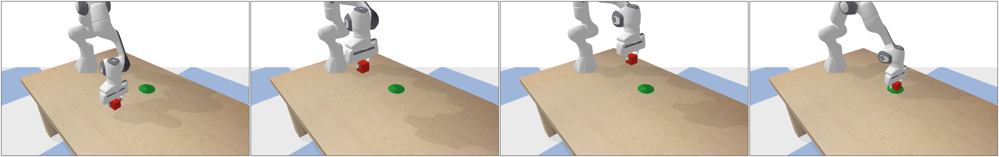
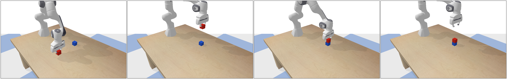

# Difficulty Matters: Curriculum Behavior Cloning in Robotic Manipulation

This repository accompanies **Difficulty Matters: A Controlled Study of Difficulty Metrics for Curriculum Behavior Cloning in Robotic Manipulation**, an NUS CS5478 research project by Xiaoda Zhong.

## Project Overview

Behavior cloning (BC) can learn robot skills from expert demonstrations, but small supervised prediction errors may compound during autonomous execution. Curriculum learning is a plausible remedy: present demonstrations in a deliberate order rather than sample every trajectory uniformly from the start. The central question here is more basic: **what makes a robot demonstration difficult?**

The study compares three trajectory-level difficulty definitions and five training strategies while holding the demonstrations, model family, optimizer, update budget, and evaluation tasks fixed. Experiments use two PyBullet manipulation tasks and report closed-loop physical success, not only offline imitation loss.

## Methodology

### Difficulty metrics

- **Task-based difficulty** combines observable task geometry, such as reach and transport distances and placement precision.
- **Expert-based difficulty** uses the demonstrator's effort: trajectory duration, end-effector path length, and cumulative Cartesian action magnitude.
- **Learner-based difficulty** is the mean held-out imitation error from five out-of-fold BC models, so every training trajectory is scored by a model that did not train on it.

### Training strategies

- **Uniform BC** samples all training transitions throughout optimization.
- **Task Curriculum**, **Expert Curriculum**, and **Learner Curriculum** order trajectories from easy to hard according to the corresponding score.
- **Reverse Learner Curriculum** presents learner-hard trajectories first.

Each curriculum uses three stages: Easy, then Easy+Medium, then the complete training set. Reverse Learner uses Hard, then Hard+Medium, then all data. Uniform uses all trajectories at every stage. Consequently, staged eligibility changes both presentation order and cumulative sample exposure; this exposure difference is an important interpretation caveat rather than a separately controlled variable.

The policy is a small state-based MLP with two 128-unit hidden layers and separate Cartesian-motion and binary-gripper heads. Motion targets are scaled during training and rescaled and clipped at inference.

## Environments

Both tasks use a Franka Panda robot and physical contacts in PyBullet.

### Pick-and-Place

The robot grasps a dynamic cube, transports it to a sampled target, releases it, and retreats. The policy observes a 10-dimensional state and emits three Cartesian deltas plus one gripper command.



### Object Stacking

The robot grasps a red source cube and places it on a dynamic blue support cube. Success requires physical source-support contact, alignment, release, retreat, low object velocities, upright poses, and a persistent stability window. The policy observes a 29-dimensional state and uses the same four-dimensional action interface.



## Installation

The verified environment uses Python 3.11. A reproducible Conda setup is provided:

```bash
conda env create -f environment.yml
conda activate cs5478
```

Alternatively, create the environment manually and install the Python requirements:

```bash
conda create -n cs5478 python=3.11 -y
conda activate cs5478
python -m pip install -r requirements.txt
```

The core dependencies are PyTorch, PyBullet, NumPy, PyYAML, Matplotlib, and pytest. CPU execution is supported; CUDA is not required. Tectonic 0.17 is included in `environment.yml` for compiling the report but is not needed for the robot experiments.

## Quick Start

Run commands from the repository root after activating `cs5478`.

### Scripted experts

```bash
python scripts/run_expert.py --episodes 20
python scripts/run_stacking_expert.py --episodes 20
```

GUI visualizers are also available as `scripts/visualize_expert.py` and `scripts/visualize_stacking_expert.py`.

### Demonstrations

The large trajectory archives are intentionally excluded from GitHub. Generate them locally, or restore the frozen archives before running the inspection commands:

```bash
# Pick-and-Place: 300 successful demonstrations, seed 5478
python scripts/collect_demos.py --num-trajectories 300 --seed 5478
python scripts/inspect_dataset.py --expected-count 300

# Object Stacking: configuration is read from configs/stacking_v1.yaml
python scripts/collect_stacking_demos.py
python scripts/inspect_stacking_dataset.py
```

Collection and training scripts protect completed artifacts from accidental replacement. Use their `--overwrite` flags only for intentional regeneration.

### Uniform BC

```bash
python scripts/train_scaled_bc.py --device cpu
python scripts/train_stacking_uniform_bc.py --device cpu
```

### Difficulty metrics

```bash
python scripts/compute_task_difficulty.py
python scripts/compute_expert_difficulty.py
python scripts/compute_learner_difficulty.py --device cpu
python scripts/inspect_difficulty.py

# Stacking difficulty/OOF pipeline
python scripts/run_stacking_s5.py --device cpu
```

### Curriculum training and evaluation

These commands are computationally expensive and require the generated datasets. Evaluation also requires locally trained checkpoints, which are not stored in GitHub.

```bash
# Pick-and-Place
python scripts/train_curricula.py --device cpu
python scripts/evaluate_curricula.py --workers 4
python scripts/generate_final_eval_tasks.py --include-spatial
python scripts/evaluate_final.py --workers 2
python scripts/analyze_final.py

# Object Stacking
python scripts/train_stacking_curricula.py --device cpu
python scripts/evaluate_stacking_curricula.py --workers 4
python scripts/evaluate_stacking_curricula.py --final --workers 4
python scripts/analyze_stacking_s5_s7.py
```

Use `--smoke` where supported for implementation checks. Do not use smoke outputs as research results.

### Tests and report

```bash
python -m pytest -q

cd report
tectonic -X compile main.tex --outdir build --keep-logs --keep-intermediates
```

## Experimental Results

Fresh in-distribution (Fresh-ID) success is averaged across training seeds 5478, 5479, and 5480.

| Method | Pick-and-Place (%) | Object Stacking (%) |
|---|---:|---:|
| Uniform | 69.33 | 8.33 |
| Task | 59.83 | 3.50 |
| Expert | 56.50 | 2.50 |
| Learner | 64.83 | 1.50 |
| Reverse Learner | **81.50** | 2.50 |

Reverse Learner achieved the highest observed Pick-and-Place mean, but the result is seed-sensitive: several methods exhibit substantial between-seed variation. The advantage did not transfer to Object Stacking, where every policy remained near the performance floor. The stacking comparison is therefore exploratory evidence about task dependence, not a precise ranking of curriculum methods.

Compact CSV/JSON summaries and report figures are published under `outputs/`. Detailed rollout records, checkpoints, and demonstration arrays remain excluded.

## Reproducibility

- **Datasets:** 300 successful trajectories per task; trajectory-level split of 240 training and 60 validation demonstrations.
- **Training seeds:** 5478, 5479, and 5480 for each curriculum method.
- **Budget:** 20,600 optimizer updates per run, with the same initialization within each seed and no early stopping for the primary curriculum comparison.
- **Development benchmarks:** 100 fixed tasks per environment.
- **Final benchmarks:** 200 Fresh-ID Pick-and-Place tasks, 100 spatial-OOD tasks, 100 precision-OOD tasks, and 200 Fresh-ID stacking tasks.
- **Dataset fingerprints:** `1b6cec9dda067778630268c307241c62cccbd49cfe849a031877ee00ea938bc0` (Pick-and-Place) and `32a8ca20314b9a4a8ac1147b5af20b3e3b16d8b755944a99c2dcf6114c073940` (Stacking).

The repository includes frozen metadata, task definitions, difficulty scores, compact result summaries, figures, source code, configs, and tests. It does **not** include the 600 compressed trajectories, model checkpoints, or raw per-rollout records. A clean clone can run environment/expert code and tests after installation; training and dataset-dependent analysis require regenerating the deterministic datasets or restoring the original frozen archives. Exact bitwise training reproduction can also depend on PyTorch, PyBullet, platform, and CPU threading versions.

## Repository Layout

```text
envs/          PyBullet task environments
expert/        Deterministic scripted experts and waypoints
data/          Sampling, trajectory, dataset, and frozen metadata code
models/        BC policy and stacking feature representation
training/      Uniform and curriculum training utilities
difficulty/    Task, Expert, and Learner scores
evaluation/    Closed-loop and benchmark evaluation code
analysis/      Difficulty and failure-analysis utilities
scripts/       Reproducible command-line entry points
configs/       Pick-and-Place and Stacking configurations
tests/         Unit and regression tests
outputs/       Compact result summaries and selected figures
report/        NeurIPS-style source and final PDF
```

## Report

- [Final report (PDF)](report/CS5478_Final_Report.pdf)
- [LaTeX source](report/main.tex)

## Author

**Xiaoda Zhong**<br>
National University of Singapore
